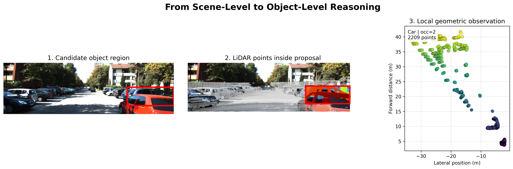
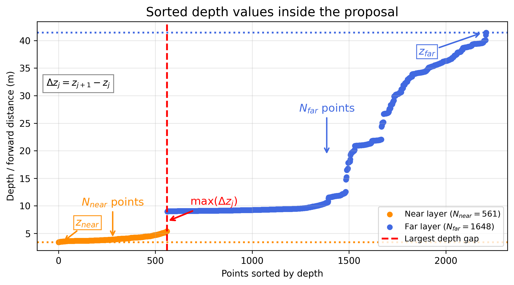

# LiDAR Occlusion Density

**Proposal-level LiDAR density and geometric occlusion assessment on KITTI**

This repository documents the density-based occlusion assessment component developed as part of the broader FuDensityNet research direction. **It does not implement or train the complete RGB–LiDAR multimodal detection network.** That work is intended for a separate FuDensityNet repository.

The method projects LiDAR into calibrated RGB camera coordinates, gathers points within supplied 2D object proposals, divides candidate points into near and far depth layers when a sufficiently large depth discontinuity is present, then estimates near-layer densities at multiple voxel scales.



## Method

1. Project LiDAR points into the image using KITTI camera calibration.
2. Gather the projected points within each supplied 2D proposal, with 5% bounding-box expansion.
3. Accept a foreground/background depth split when the largest gap is at least 3 m and both layers contain at least two points.
4. Calculate voxel-density descriptors using 0.25 m, 0.50 m, and 1.00 m scales.
5. Apply calibration-based descriptor normalization and combine the density, depth-gap, and near/far balance cues.

```text
OR_density = 0.50 D_small + 0.30 D_medium + 0.20 D_large
OR = 0.70 OR_density + 0.20 D_gap + 0.10 D_balance
```

`D_gap` is calibrated from the largest raw depth gap using training-calibration percentiles; `D_balance` measures near/far point balance. See `src/fudensitynet/or_score.py` for exact implementation details.



## Evaluation

KITTI experiments used **ground-truth bounding boxes as oracle proposals**, not predictions from a deployed object detector. The task was discrimination of visible (occlusion label 0) versus annotated occluded (labels 1–2) proposals.

| Metric across five frame-disjoint splits | Mean ± SD |
| --- | ---: |
| ROC AUC | 0.647 ± 0.015 |
| Average precision | 0.631 ± 0.018 |
| Balanced accuracy | 0.614 ± 0.016 |
| Calibrated OR threshold | 12 |

These are **occlusion assessment**, not object-detection metrics; the repository does not contain a trained multimodal detection model. The results summarize earlier experiments, not a rerun of the entire KITTI study from the bundled unit tests. See [results/README.md](results/README.md).

## Repository layout

```text
src/fudensitynet/   Geometry, KITTI interfaces and OR scoring
scripts/            Evaluation, proposal scoring and plotting
notebooks/          Worked scoring example
figures/            Research presentation figures
results/            Recorded evaluation summaries
tests/              Unit tests
```

## Installation

Python 3.10+ is recommended.

```bash
python -m pip install -e '.[dev]'
python -m pytest -q
```

## Example usage

With KITTI object training images, LiDAR scans, calibration and labels available locally:

```bash
python scripts/evaluate_kitti.py --kitti-training /path/to/kitti_dataset/training --max-frames 500 --seed 42 --output-dir runs/seed42
```

For externally provided 2D proposals and a previously fitted calibration:

```bash
python scripts/score_proposals.py --image image.png --velodyne scan.bin --calib calib.txt --boxes examples/proposals.json --calibration runs/seed42/calibration.json
```

No raw KITTI data or pretrained weights are distributed here. The scoring package retains the original Python module name `fudensitynet` for compatibility; the repository title describes its narrower research scope.

## Research context

The research presentation at the University of Antwerp also discusses future detector integration, RGB–LiDAR fusion and distance-aware routing. Those stages are **not claimed as completed implementations in this repository**.
